# 光伏电站故障诊断知识库

> 根据 `1.jpg` 长图中可辨认的课件页面整理，原资料标注为 102 页，但截图只显示部分页面。以下是常见故障线索，不是完整维修手册。数字、标准号和技术限值均须用现行标准、设备手册、设计文件和现场规程核实。

## 发电量和系统效率

- 课件给出的关系式：理论年发电量 = 年平均太阳辐射总量 × 电池总面积 × 光电转换效率；实际年发电量 = 理论年发电量 × 实际发电效率。
- 课件将 PR 描述为交流端发电量与理想直流发电量之比，用于观察系统综合性能。分析时先确认 PR 定义、数据口径、时间窗及辐照/温度校正方式。
- 发电异常常见影响面：太阳辐射、组件朝向/倾角、组件衰减与失配、积尘、温度、遮挡/积雪、直流与交流线路、变压器、逆变器 MPPT/转换效率以及停机/限电。
- 比较发电量时，应区分资源变化、设备可用率、限电、通讯和测量问题；不要把一次性产量差异直接归因于设备故障。

## 典型现象与排查方向

| 现象 | 可能方向 | 安全诊断思路 |
|---|---|---|
| 单个组串或 MPPT 输出偏低 | 遮挡/积雪/积尘、组件失配或衰减、连接/布线异常、局部组件故障 | 先比较同辐照时段的同类组串和历史数据；现场检查、I-V/电气测量由合格人员按规程实施 |
| 逆变器屏幕无显示 | 直流输入不足、直流开关状态、输入极性/接线问题、组串连接异常、设备自身故障或供电问题 | 从告警和监控数据开始；现场电气检查须先确认隔离条件。持续故障交由厂家/专业人员处理，不自行拆机 |
| 逆变器停机或交流断路器动作 | 保护动作、交流回路问题、过温/通风不良、内部器件或外部电网异常 | 保存完整事件记录和动作时间，区分设备告警与通讯中断；禁止反复强送电，按规程查因 |
| 保险丝熔断或浪涌保护器异常 | 浪涌保护器模块损坏、相对地异常或其他短路/过流原因 | 不只更换熔丝；由专业人员按规程查明故障和绝缘情况、确认保护器状态，再决定恢复运行 |
| 交流配电柜进线接线疑似错误 | 相序、相线/零线或回路标识错误 | 依据批准图纸由合格人员核对；错误接线可能损坏设备，禁止带电试错 |
| 监控数据异常或缺失 | 通讯中断、采集设备/供电故障、数据时间/映射问题，或实际设备异常 | 先对照本机指示、事件日志和相邻设备，区分“无数据”和“无发电” |
| 组件或接线盒异常温升、热斑 | 遮挡、局部短路、连接/焊接缺陷、异物、老化等 | 保留红外/可见光图像和环境条件，交由专业人员评估；烧蚀、烟雾、拉弧时按应急流程处置 |
| 组件裂片、脱层、闪电纹或接线盒损伤 | 制造质量、热循环、搬运/安装应力、密封或接线工艺问题 | 标记组件位置与电气归属，记录外观和性能变化，评估隔离/更换需遵照现场规程和制造商意见 |

### 截图中的可见缺陷图例

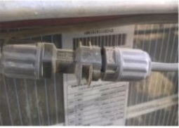
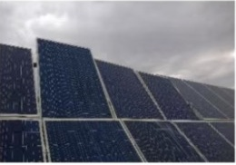
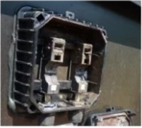
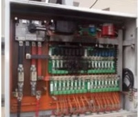
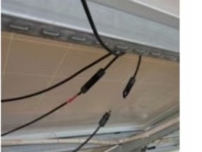
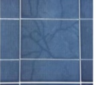

## 环境与性能因素

### 辐射、朝向和倾角

课件指出辐射量直接影响组件输出，倾角需结合当地纬度和气象条件选择，并建议用气象资料或光伏设计工具估算。图中倾角经验值不是设计规范，实际项目应以所在地辐照数据、遮挡条件、结构安全和设计计算为准。

### 组串和线路损失

- 组件电流不一致会导致串联失配；并联输入不一致可能带来汇流和 MPPT 损失。对比同型号、同朝向、同辐照下的数据。
- 连接头断裂、接线盒损坏、组件/电缆松动和接触异常均需作为潜在电气安全问题升级处理。
- 线路损失检查应覆盖导线、端子、连接器、汇流箱、逆变器至并网点回路；测量和紧固必须由合格人员按停电和验电程序实施。

### 灰尘、温度、阴影和积雪

- 积尘会遮光并影响散热；依现场污染和气候制定清洁周期，不可使用可能损坏玻璃、涂层或密封件的工具/清洁剂。
- 课件列出的晶硅组件典型功率温度系数约为 -0.35%～-0.40%/°C；此值因组件型号不同而异，应优先使用组件数据表。
- 阴影来源包括周边建筑、树木、女儿墙、阵列前后排、支架及管线、设备。部分遮挡可能造成失配和热斑。
- 落叶、鸟粪、积雪等不均匀覆盖物可能导致局部遮挡。清理方式应考虑高处作业、电气风险、组件表面和天气条件。
- 课件建议春秋开展遮挡排查，并定期红外巡检；周期应根据项目风险和维护制度确认。

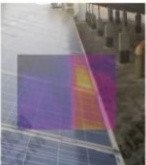
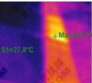
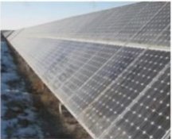

### 热斑机理及风险

当组串内局部电池片输出能力明显偏低时，可能反向受电并产生局部发热。遮挡、局部短路、异物和焊接/连接缺陷都可能相关。长期热斑可能造成封装材料老化、组件失效或火灾风险。热像读数需要结合辐照、负载、发射率、拍摄角度及设备状态解释，不能单凭一张热像图判定根因。

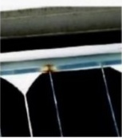
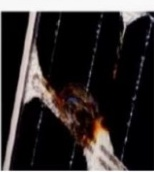
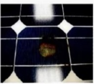

## 组件制造/质量问题线索

| 缺陷 | 课件列出的可能成因 | 风险或预防线索 |
|---|---|---|
| 虚焊、过焊 | 焊接温度、时间、助焊剂用量或速度不当 | 可能导致脱层、功率下降或电池片损伤；依工艺控制参数并加强 EL 检查 |
| EVA 脱层 | 层压温度/时间不足、原材料表面异物或材料不均 | 可能导致组件性能下降、进水或失效；检查层压工艺、原料和交联度 |
| 接线盒起火 | 引线未卡紧、焊接面积不足、引线过长并接触塑料件 | 具有起火风险；按批准 SOP 控制安装、焊接和引线长度 |
| 硅胶不良、分层、交叉隐裂 | 密封不良、异物、层压问题或外力冲击 | 可能进水、短路或功率衰减；加强密封、来料检查和搬运保护 |
| 电池裂片 | 焊接、搬运或层压过程操作不当 | 可能降低组件功率；遵照工艺操作并通过 EL 等方法检验 |
| 助焊剂过量 | 设备喷射或人工涂抹过量 | 可能造成主栅区域脱层/闪电纹；依工艺文件限定用量 |

原截图提及的交联度约 85%±5%、接线盒焊接面积大于 20 mm² 等内容仅是课件中的数值，不能直接套用于不同产品或现行验收。应以对应组件/工艺文件为准。

## 事故和规程

截图摘录的事故处理原则包括：限制事故发展、消除事故根源、保护人身和设备、尽可能保持或恢复供电、调整运行方式并及时向调度汇报。该摘要不能替代调度规程、工作票、安全规程或应急预案。所有隔离、接地、送电和保护操作均须遵守适用规程及授权。
